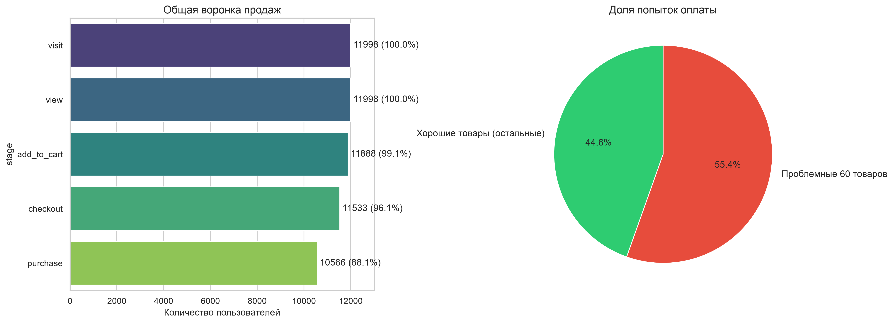

# Анализ воронки продаж в E-commerce (User Funnel Analysis)

## 📌 О проекте
Данный проект представляет собой анализ пользовательской воронки в интернет-магазине. Цель — найти «узкое горлышко» (этап с самым большим оттоком клиентов), определить корневую причину проблемы и сформулировать рекомендации для бизнеса.
**Данные:** [Ссылка на датасет Kaggle](https://www.kaggle.com/datasets/yashch05/user-event-funnel-and-retention-analytics-dataset) *(Файл также прикреплен в репозитории)*

## 🎯 Бизнес-задача
Понять, на каком этапе (от визита до покупки) теряется больше всего пользователей, и выяснить, почему это происходит.

## 🛠 Инструменты
*   **Python:** Pandas, NumPy
*   **Визуализация:** Matplotlib, Seaborn
*   **Методы:** Когортный анализ, группировки, кумулятивный пересчет (исправление аномалий трекинга)

## 🔍 Этапы исследования
1.  **Data Profiling и исправление аномалий:** При первичном расчете обнаружено, что на этапе `view` пользователей больше, чем на этапе `visit` (баг трекера). Применен метод кумулятивного пересчета (снизу вверх), чтобы воронка отражала реальный путь клиента. Логика обернута в функцию `build_funnel()` для переиспользования.
2.  **Построение общей воронки:** Сквозная конверсия составила 88%. Выявлено узкое горлышко: этап `checkout -> purchase` (потеря около 8.4% пользователей, бросающих корзину на оплате).
3.  **Сегментация (поиск корневой причины):** Были последовательно проверены и отклонены гипотезы:
    *   *Тип устройства (Mobile/Web):* конверсия идентична (66.5% vs 66.3%).
    *   *Источник трафика:* Organic, Ads, Email, Referral дают одинаковую конверсию (~88%).
    *   *Страна пользователя:* конверсия в пределах 72-74%, аномалий нет.
    *   *Стоимость товара:* средняя цена брошенных корзин не отличается от купленных.
    *   *Категория товара:* конверсия стабильна во всех категориях.
4.  **Глубокий анализ на уровне товаров (product_id):** Анализ конкретных товаров выявил **60 позиций** с аномально низкой конверсией (7-9% вместо средних 72%). При этом на эти 60 товаров приходится **55.42%** всех попыток оформления заказа.

## 📈 Результаты и Рекомендации

**Вывод:**
Проблема массового отвала клиентов на этапе оплаты вызвана не платформой или маркетингом, а техническими ошибками с конкретными 60 товарами. Более половины клиентов, готовых купить, отваливаются именно на них.

**Рекомендации для бизнеса:**
1. **Технический аудит:** Передать список 60 «проблемных» `product_id` команде разработки для проверки страницы оплаты (ошибки расчета доставки, отсутствие товара на складе).
2. **Мониторинг:** Внедрить автоматические алерты для продуктовой команды: если конверсия конкретного товара падает ниже 30%, отправлять уведомление.
3. **Ожидаемый эффект:** Устранение этих багов позволит восстановить до 55% «потерянных» заказов и значительно увеличить общую выручку магазина.